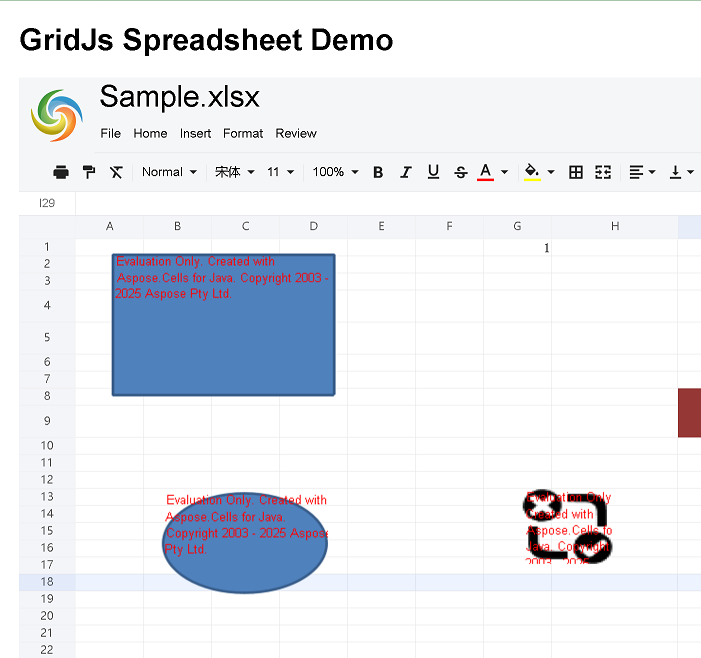

# Load Spreadsheet with GridJs (Flask)

## Overview

This article demonstrates how to build a minimal web application that loads an Excel workbook into the **GridJs** client UI, using **Aspose.Cells GridJs** on the server side and **Flask** as the web framework.  
The solution covers:

* Server‑side initialization of `GridJsService`.
* Flask routes that expose all GridJs actions (load, update, image handling, file download, etc.).
* Client‑side HTML/JavaScript that creates the GridJs UI, queries the server, and handles user interactions.
* A ready‑to‑run project layout.

> **Note** – All code snippets are complete, runnable, and follow the strict project structure required by the specification.

## Project Structure

```
your‑project/
│
├─ app.py                     # Flask entry point (provided below)
├─ cache/                     # Auto‑created by GridJs for temporary files
├─ data/
│   └─ sample.xlsx            # Sample workbook used in the demo
├─ static/
│   └─ js/
│       └─ gridjs-demo.js     # Client‑side JavaScript (provided)
├─ templates/
│   └─ index.html             # Main HTML page (provided)
└─ screenshots/
    └─ gridjs_ui.png          # UI screenshot (placeholder)
```

> **Important** – Keep the folder names exactly as shown; Flask will look for HTML files under `templates/` and static assets under `static/`.

## Server‑Side: Flask + Aspose.Cells GridJs

### Installation

```bash
pip install aspose-cells-gridjs-net-python flask requests
```

### `app.py` (Complete, Runnable)

```python
# app.py
# -------------------------------------------------------------
# Flask application that hosts Aspose.Cells GridJs services.
# -------------------------------------------------------------

from flask import (
    Flask,
    render_template,
    request,
    jsonify,
    Response,
    send_file,
    abort,
)
import io
import gzip
import mimetypes
import os

# Aspose.Cells GridJs imports
from aspose.cellsgridjs import GridJsOptions, GridJsService

app = Flask(__name__)

# -------------------------------------------------------------
# GridJs service initialization
# -------------------------------------------------------------
options = GridJsOptions()
options.file_cache_directory = "./cache"           # Cache folder (must exist)
options.base_route_name = "/GridJs"                # Base route used by the client
gridjs_service = GridJsService(options)

# Ensure cache folder exists
os.makedirs(options.file_cache_directory, exist_ok=True)

# -------------------------------------------------------------
# Helper: Guess MIME type from a filename
# -------------------------------------------------------------
def guess_mime_type_from_filename(filename: str) -> str:
    mime_type, _ = mimetypes.guess_type(filename)
    return mime_type or "application/octet-stream"


# -------------------------------------------------------------
# Root route – renders the UI
# -------------------------------------------------------------
@app.route("/")
def index():
    return render_template("index.html")


# -------------------------------------------------------------
# 1️⃣ Load spreadsheet JSON (gzipped)
# -------------------------------------------------------------
@app.route("/GridJs/LoadSpreadsheet", methods=["GET"])
def load_spreadsheet():
    uid = request.args.get("uid", "")
    # Prepare an in‑memory gzip stream
    gzip_buffer = io.BytesIO()
    with gzip.GzipFile(fileobj=gzip_buffer, mode="w") as gz:
        # Populate the gzip stream with GridJs JSON data
        gridjs_service.detail_stream_json_with_uid(gz, "./data/sample.xlsx", uid)
    gzip_buffer.seek(0)
    return Response(
        gzip_buffer.getvalue(),
        mimetype="application/json",
        headers={"Content-Encoding": "gzip"},
    )


# -------------------------------------------------------------
# 2️⃣ Update a cell (POST)
# -------------------------------------------------------------
@app.route("/GridJs/UpdateCell", methods=["POST"])
def update_cell():
    p = request.form.get("p")
    uid = request.form.get("uid")
    ret = gridjs_service.update_cell(p, uid)
    return Response(ret, content_type="text/plain; charset=utf-8")


# -------------------------------------------------------------
# 3️⃣ Add image (multipart/form‑data)
# -------------------------------------------------------------
@app.route("/GridJs/AddImage", methods=["POST"])
def add_image():
    uid = request.form.get("uid")
    p = request.form.get("p")
    is_control = request.form.get("control")
    file = request.files.get("image")          # May be None – handled below
    file_bytes = io.BytesIO(file.read()) if file else None
    ret = gridjs_service.add_image(p, uid, is_control, file_bytes)
    return jsonify(ret)


# -------------------------------------------------------------
# 4️⃣ Copy image
# -------------------------------------------------------------
@app.route("/GridJs/CopyImage", methods=["POST"])
def copy_image():
    uid = request.form.get("uid")
    p = request.form.get("p")
    ret = gridjs_service.copy_image(p, uid)
    return jsonify(ret)


# -------------------------------------------------------------
# 5️⃣ Add image by external URL
# -------------------------------------------------------------
@app.route("/GridJs/AddImageByURL", methods=["POST"])
def add_image_by_url():
    uid = request.form.get("uid")
    p = request.form.get("p")
    image_url = request.form.get("imageurl")
    ret = gridjs_service.add_image_by_url(p, uid, image_url)
    return jsonify(ret)


# -------------------------------------------------------------
# 6️⃣ Retrieve an image (GET)
# -------------------------------------------------------------
@app.route("/GridJs/Image", methods=["GET"])
def image():
    img_id = request.args.get("id")
    uid = request.args.get("uid")
    if not img_id or not uid:
        return "Missing required parameters", 400
    image_bytes = gridjs_service.image(uid, img_id)
    return send_file(
        image_bytes,
        as_attachment=False,
        download_name=img_id,
        mimetype="image/png",
    )


# -------------------------------------------------------------
# 7️⃣ Retrieve an embedded OLE object (GET)
# -------------------------------------------------------------
@app.route("/GridJs/Ole", methods=["GET"])
def ole():
    obj_id = request.args.get("id")
    uid = request.args.get("uid")
    sheet = request.args.get("sheet")
    filename = None
    file_bytes = gridjs_service.ole(uid, sheet, obj_id, filename)
    if filename:
        return send_file(
            io.BytesIO(file_bytes),
            as_attachment=True,
            download_name=filename,
            mimetype=guess_mime_type_from_filename(filename),
        )
    abort(400, "File not found")


# -------------------------------------------------------------
# 8️⃣ Batch image URLs (GET)
# -------------------------------------------------------------
@app.route("/GridJs/ImageUrl", methods=["GET"])
def image_url():
    img_id = request.args.get("id")
    uid = request.args.get("uid")
    ret = gridjs_service.image_url(options.base_route_name, img_id, uid)
    return jsonify(ret)


# -------------------------------------------------------------
# 9️⃣ Download cached file (GET)
# -------------------------------------------------------------
@app.route("/GridJs/GetFile", methods=["GET"])
def get_file():
    file_id = request.args.get("id")
    file_bytes = gridjs_service.get_file(file_id)
    return send_file(
        file_bytes,
        as_attachment=True,
        download_name=file_id,
        mimetype=guess_mime_type_from_filename(file_id),
    )


# -------------------------------------------------------------
# 🔟 Trigger file download (POST)
# -------------------------------------------------------------
@app.route("/GridJs/Download", methods=["POST"])
def download():
    p = request.form.get("p")
    uid = request.form.get("uid")
    file_name = request.form.get("file")
    ret = gridjs_service.download(p, uid, file_name)
    return jsonify(ret)


# -------------------------------------------------------------
# Application entry point
# -------------------------------------------------------------
if __name__ == "__main__":
    # Listen on all interfaces as required
    app.run(host="0.0.0.0", port=5000, debug=True)
```

> **Important** – The root route `/` **must** render `templates/index.html`. The application runs on `0.0.0.0:5000` as stipulated.

## Client‑Side: HTML + JavaScript

### `templates/index.html`

```html
<!-- templates/index.html -->
<!DOCTYPE html>
<html lang="en">
<head>
    <meta charset="UTF-8">
    <title>GridJs Spreadsheet Demo</title>

    <!-- jQuery & UI -->
    <script src="https://code.jquery.com/jquery-2.1.1.min.js"></script>
    <script src="https://code.jquery.com/ui/1.12.1/jquery-ui.min.js"></script>
    <link rel="stylesheet"
          href="https://code.jquery.com/ui/1.12.1/themes/base/jquery-ui.css">

    <!-- JSZip (required by GridJs) -->
    <script src="https://cdnjs.cloudflare.com/ajax/libs/jszip/3.6.0/jszip.min.js"></script>

    <!-- GridJs Spreadsheet UI -->
    <link rel="stylesheet"
          href="https://unpkg.com/gridjs-spreadsheet/xspreadsheet.css">
    <script src="https://unpkg.com/gridjs-spreadsheet/xspreadsheet.js"></script>

    <!-- Demo helper script -->
    <script src="{{ url_for('static', filename='js/gridjs-demo.js') }}"></script>

    <style>
        body {font-family: Arial, sans-serif; margin: 20px;}
        #gridjs-demo-uid {border: 1px solid #ccc;}
    </style>
</head>
<body>
    <h1>GridJs Spreadsheet Demo</h1>

    <!-- Container for the GridJs UI -->
    <div id="gridjs-demo-uid"></div>

    <!-- Optional: show a screenshot -->
    <p>
        
    </p>
</body>
</html>
```

### `static/js/gridjs-demo.js`

```javascript
/* static/js/gridjs-demo.js */
/* -------------------------------------------------------------
   Client‑side script that initializes GridJs, loads the workbook,
   and wires up all server‑side URLs.
   ------------------------------------------------------------- */

(function ($) {
    // ---------- 1. Helper: generate a UUID ----------
    function generateUUID() {
        // Simple RFC4122 version 4 UUID
        return 'xxxxxxxx-xxxx-4xxx-yxxx-xxxxxxxxxxxx'.replace(/[xy]/g, function (c) {
            var r = Math.random() * 16 | 0,
                v = c === 'x' ? r : (r & 0x3 | 0x8);
            return v.toString(16);
        });
    }

    // ---------- 2. Define server URLs ----------
    const queryJsonUrl      = "/GridJs/LoadSpreadsheet";
    const updateUrl         = "/GridJs/UpdateCell";
    const fileDownloadUrl   = "/GridJs/Download";
    const oleDownloadUrl    = "/GridJs/Ole";
    const imageurl          = "/GridJs/ImageUrl";
    const imageuploadurl1   = "/GridJs/AddImage";
    const imageuploadurl2   = "/GridJs/AddImageByURL";
    const imagecopyurl      = "/GridJs/CopyImage";

    const zorder = 1000;               // Canvas Z‑order
    let xs;                            // GridJs instance
    const uid = generateUUID();        // Unique session id

    // ---------- 3. Load workbook JSON ----------
    $.ajax({
        url: queryJsonUrl,
        method: "GET",
        data: { uid: uid },
        dataType: "json",
        // The server returns gzip‑compressed JSON; browsers decompress automatically.
        success: function (responseData) {
            const jsondata = typeof responseData === "string"
                ? JSON.parse(responseData)
                : responseData;

            const option = {
                updateMode: "server",
                updateUrl: updateUrl,
                locale: 'en', // UI language
                mode: 'read',
                //enable redaction feature
                enableRedactionShape: true,
                redactionDefaultColor: 'green',
                redactionReasons: ['PII - Personal Information',
					'Confidential Business',
					'Legal Privilege',
					'Trade Secret',
					],
            };

            loadWithOption(jsondata, option);
        },
        error: function (xhr) {
            console.error("Failed to load spreadsheet:", xhr);
        }
    });

    // ---------- 4. Render the UI ----------
    function loadWithOption(jsondata, option) {
        $('#gridjs-demo-uid').empty();

        const sheets = jsondata.data;
        const filename = jsondata.filename;

        // Initialise GridJs (x_spreadsheet) and bind to the container
        xs = x_spreadsheet('#gridjs-demo-uid', option)
            .loadData(sheets)
            .updateCellError(msg => console.error(msg));

        // Hide the bottom sheet bar when tabs are disabled
        if (!jsondata.showtabs) {
            xs.bottombar.hide();
        }

        xs.setUniqueId(jsondata.uniqueid);
        xs.setFileName(filename);

        // Activate the appropriate sheet & cell
        let activeSheetName = jsondata.actname;
        if (xs.bottombar.dataNames.includes(activeSheetName)) {
            xs.setActiveSheetByName(activeSheetName)
              .setActiveCell(jsondata.actrow, jsondata.actcol);
        } else {
            // Fallback to the first visible sheet
            activeSheetName = xs.bottombar.dataNames[0];
            xs.setActiveSheetByName(activeSheetName).setActiveCell(0, 0);
        }

        // ---------- 5. Register auxiliary URLs ----------
        xs.setImageInfo(
            imageurl,
            imageuploadurl1,
            imageuploadurl2,
            imagecopyurl,
            zorder,
            "/image/loading.gif"
        );
        xs.setFileDownloadInfo(fileDownloadUrl);
        xs.setOleDownloadInfo(oleDownloadUrl);
        xs.setOpenFileUrl("/GridJs/Index");
    }

})(jQuery);
```

## Running the Demo

1. **Create the folder layout** shown above.
2. Place a sample workbook at `./data/sample.xlsx`.  
   *(Any valid `.xlsx` file works; the demo uses it as the source.)*
3. Ensure the `cache/` directory exists or let the app create it automatically.
4. Start the Flask server:

   ```bash
   python app.py
   ```

5. Open a browser and navigate to `http://localhost:5000/`.  
   The GridJs UI loads the workbook, and you can edit cells, insert images, download files, etc.

> [!TIP]
> When testing locally, the browser automatically decompresses the gzip‑encoded JSON response from `/GridJs/LoadSpreadsheet`. No extra handling is required on the client side.
 

## Screenshots

| UI View |
|---------|
|  |

> The above image shows the spreadsheet rendered inside the `<div id="gridjs-demo-uid"></div>` container after a successful load.

## Common Issues & Fixes

| Symptom | Cause | Resolution |
|---------|-------|------------|
| `FileNotFoundError` for `sample.xlsx` | The sample file is missing or path is incorrect. | Verify that `./data/sample.xlsx` exists relative to `app.py`. |
| 404 for static JS/CSS | Flask cannot locate `static/` assets. | Ensure the file `gridjs-demo.js` resides under `static/js/` and that the `<script src="{{ url_for('static', filename='js/gridjs-demo.js') }}"></script>` tag is present. |
| CORS errors when accessing external image URLs | Browser blocks cross‑origin requests. | The server's `add_image_by_url` endpoint fetches the image server‑side, so CORS is not an issue. |
| Spreadsheet does not show tabs | `showtabs` flag is false in the JSON. | The demo hides the bottom bar automatically; modify server logic if you need tabs displayed. |

{}
**Remember:** Do **not** use `app.send_static_file` for HTML pages. All HTML must be rendered via `render_template`, as demonstrated in the root route.
{}

## Further Reading

* **GridJs Redaction Feature** – <https://docs.aspose.com/cells/python-net/aspose-cells-gridjs/how-to-use-redaction/>
* **GridJs API Reference** – <https://reference.aspose.com/cells/python-net/aspose.cellsgridjs>
* **Aspose.Cells for Python via .NET Documentation** – <https://docs.aspose.com/cells/python-net/>
* **Demo Source** – <https://github.com/aspose-cells/Aspose.Cells.Grid-for-Java/tree/main/Examples.GridJs.Redaction>
* **gridjs-spreadsheet NPM Package** – <https://www.npmjs.com/package/gridjs-spreadsheet>

---